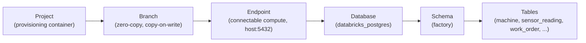

# 00 · Setup — get connected

This is the on-ramp. About 20 minutes, done once, and it unblocks every journey. By the end you
have a live Lakebase project, the access it needs, and **your own zero-copy branch** to work on.

> **Tip**
> If a term or acronym is unfamiliar anywhere in the workshop, the [glossary](../docs/glossary.md)
> defines it in plain language.

Work through these in order:

| Step | File | What it does |
| ---- | ---- | ------------ |
| 1 | [`prereqs.md`](prereqs.md) | Tools you need: Databricks workspace access, the CLI, Python, and two libraries. |
| 2 | [`auth.md`](auth.md) | Log in to your Databricks workspace so the CLI and SDK can act as you. |
| 3 | [`provision.md`](provision.md) | Create the workshop's Lakebase project (or point at a shared one), so you never touch the live demo. |
| 4 | [`grants.md`](grants.md) | Grant the access the workshop needs: a Postgres role, schema grants, and the project permission that lets you branch. |
| 5 | [`your-branch.md`](your-branch.md) | Create your personal zero-copy branch `u-<name>` and load the factory schema onto it. |
| 6 | [`verify.md`](verify.md) | Connect, run `SELECT 1`, and confirm your branch is live and serving. |

## Why a branch per person

Everyone in the workshop shares one factory database, but you each get your **own branch** of
it. A branch is a full, isolated copy of the data that is free to create because Lakebase
branches are copy-on-write: nothing is duplicated until you change it. So a whole room can run
the workshop at the same time, each person breaking and rebuilding their own copy, without
touching anyone else's, and without touching the shared production data underneath.

That is the first real Lakebase idea in this workshop, and you use it before you even start:
your branch is where every journey runs. When you are done, dropping your branch leaves nothing
behind.

## The object model you're about to build in

Lakebase organizes storage and compute like this:

A **project** holds everything. Inside it, **branches** are the git-style copies (production is
the default; yours is `u-<name>`). Each branch exposes an **endpoint**, the compute you actually
connect to over the Postgres wire. Behind the endpoint is a normal Postgres **database** with a
**schema** and your factory **tables**.

## Meet the factory

Every journey runs against one running example: a multi-plant smart-manufacturing operation, in
the `factory` schema. You load it onto your branch in [`your-branch.md`](your-branch.md). Getting
to know the cast now means the journeys read easily later, because the same machines, parts, and
orders show up throughout.

- **Three plants**, run by two business units: `PL-DETROIT` and `PL-AUSTIN` (operator NorthAxle),
  and `PL-MUNICH` (operator EuroDrive). Each has production lines.
- **Machines** on those lines, named `M-1xx` at Detroit, `M-3xx` at Austin, `M-4xx` at Munich.
  The recurring one to know is **`M-204`**, a stamping press on Detroit's Stamping-B line. It
  starts out `healthy` at 91% health, and it's the machine you'll fork, break, re-tag, and
  diagnose across several journeys. When you see `M-204`, that's the one.
- **Sensor readings** stream off each machine (temperature, vibration, rpm, load). `M-204` has a
  vibration reading quietly creeping up, which the maintenance journeys pick up on.
- **A bill of materials**: products built from parts built from sub-parts. `PRD-GEARBOX-X1` is a
  gearbox made of a housing, two gear assemblies, and bolts; each gear assembly is a gear plus
  two bearings. That tree is what the recursive-query and knowledge-graph journeys walk.
- **Work orders and operations** (the shop floor), **suppliers, warehouses, and inventory** (the
  supply chain), and **maintenance write-ups** (free text the AI journeys learn to read).

You don't need to memorize any of this. It's seeded for you, and each journey reintroduces the
few rows it touches. `M-204` is just the character worth remembering.

## When you're done

You'll have connected to your own branch and seen `SELECT 1` return. Then head to
[`../journeys/`](../journeys/) and start with **Branch the brain** — the same branching you just
used, turned into a hands-on journey.

> **Note**
> If any CLI or script step fails with an authentication or "refresh token" error, your login
> has expired. Re-run the login from [`auth.md`](auth.md) and try again. Each journey's `faq.md`
> lists the specific errors for that journey.
