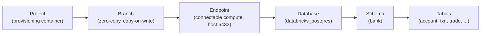

# 00 · Setup, get connected

This is the on-ramp. About 20 minutes, done once, and it unblocks every journey. By the end you
have a live Lakebase project, the access it needs, and **your own zero-copy branch** to work on.

> **Tip**
> If a term or acronym is unfamiliar anywhere in the workshop, the [glossary](../docs/glossary.md)
> defines it in plain language.

Work through these in order:

| Step | File | What it does |
| ---- | ---- | ------------ |
| 1 | [`prereqs.md`](prereqs.md) | Tools you need: Databricks workspace access, the CLI, Python, and two libraries. |
| 2 | [`auth.md`](auth.md) | Log in to your Databricks workspace so the CLI and SDK can act as you. |
| 3 | [`provision.md`](provision.md) | Create the workshop's Lakebase project (or point at a shared one), so you never touch the live demo. |
| 4 | [`grants.md`](grants.md) | Grant the access the workshop needs: a Postgres role, schema grants, and the project permission that lets you branch. |
| 5 | [`your-branch.md`](your-branch.md) | Create your personal zero-copy branch `u-<name>` and load the bank schema onto it. |
| 6 | [`verify.md`](verify.md) | Connect, run `SELECT 1`, and confirm your branch is live and serving. |

## Working only in Databricks?

You don't need a laptop, the CLI, or `workshop.env`. Your instructor does steps 3 and 4 once, before
the session: create the project and grant your group `CAN_MANAGE` on it. Then open
[`setup_databricks`](setup_databricks.py) in the workspace and run it top to bottom. It installs the
Postgres driver, creates your branch, loads the bank, and runs `SELECT 1`. After that, follow the
[`START_HERE`](../START_HERE.py) notebook at the top of the repo: Part 1, then one of the two Part 2
tracks. Each journey notebook starts with the same install and widget cells, and ends with a link to
the next one.

## Why a branch per person

Everyone in the workshop shares one bank database, but you each get your **own branch** of
it. A branch is a full, isolated copy of the data that is free to create because Lakebase
branches are copy-on-write: nothing is duplicated until you change it. So a whole room can run
the workshop at the same time, each person breaking and rebuilding their own copy, without
touching anyone else's, and without touching the shared production data underneath.

That is the first real Lakebase idea in this workshop, and you use it before you even start:
your branch is where every journey runs. When you are done, dropping your branch leaves nothing
behind.

## The object model you're about to build in

Lakebase organizes storage and compute like this:

A **project** holds everything. Inside it, **branches** are the git-style copies (production is
the default; yours is `u-<name>`). Each branch exposes an **endpoint**, the compute you actually
connect to over the Postgres wire. Behind the endpoint is a normal Postgres **database** with a
**schema** and your bank **tables**.

## Meet the bank

Every journey runs against one running example: a multi-branch financial institution in
the `bank` schema. You load it onto your branch in [`your-branch.md`](your-branch.md). Getting
to know the cast now means the journeys read easily later, because the same branches, accounts, and
trades show up throughout.

- **Three branches**, run by two business units: `BR-NYC` and `BR-SFO` (operator RetailBank),
  and `BR-LON` (operator GlobalMarkets). Each serves different market segments.
- **Accounts** across those branches, named `ACCT-100xxx` at NYC, `ACCT-200xxx` at SFO, `ACCT-300xxx` at London.
  The recurring one to know is **`ACCT-100240`**, a retail credit account at NYC on a `watch` status that
  you'll track, query, and diagnose for fraud across several journeys. When you see `ACCT-100240`, that's the one.
- **Transactions** flow through each account (card charges, transfers, wires). `ACCT-100240` has
  a series of transactions, including a suspicious high-value one, you'll analyze through the data journeys.
- **A holdings hierarchy**: funds hold instruments, and some holdings are sleeves (an instrument that
  itself holds other instruments). `FUND-GROWTH-A` holds Microsoft, cash, and an equity sleeve, and that
  sleeve in turn holds Apple and a Treasury; that two-level tree is what the recursive-query and
  knowledge-graph journeys walk.
- **Trades and settlements** (execution side), **counterparties, custodians, and positions** (the portfolio),
  and **case notes** (free text the AI journeys learn to read).

You don't need to memorize any of this. It's seeded for you, and each journey reintroduces the
few rows it touches. `ACCT-100234` is just the character worth remembering.

## When you're done

You'll have connected to your own branch and seen `SELECT 1` return. Then head to
[`../journeys/`](../journeys/) and start with **Branch the brain**, the same branching you just
used, turned into a hands-on journey.

> **Note**
> If any CLI or script step fails with an authentication or "refresh token" error, your login
> has expired. Re-run the login from [`auth.md`](auth.md) and try again. Each journey's `faq.md`
> lists the specific errors for that journey.
