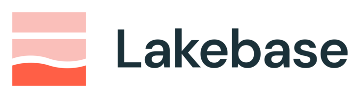
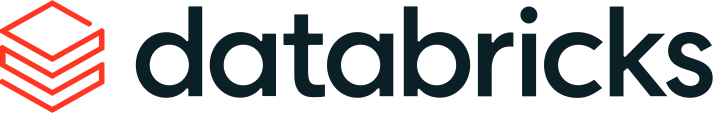

> ## ✅ Finance & banking edition
>
> This repository is the **finance / banking** edition of the Lakebase Workshop: all 31
> journeys are authored around a retail-and-markets bank and run end to end against a live
> Lakebase, with expected results that reflect real measured output.

# Lakebase Workshop

**Build a live bank on Lakebase, then do things to it that a normal database can't survive.**

You run a bank: branches full of accounts, card and wire transactions streaming in, trades moving
to settlement, funds that hold instruments through sleeves, counterparties and custodians behind
them, and analysts writing fraud and AML case notes all day. In this workshop that operation is
real, it runs on **Lakebase** (the operational database built into Databricks), and *you* drive
it. Not a slide deck. Not a recorded demo. Your own live database, your own commands, your own
results to check against.

Lakebase speaks standard PostgreSQL, so the SQL and the drivers you already know just work. But
the reason this workshop exists is everything Lakebase adds *around* that engine: branch a whole
database in seconds, rewind it in time, scale its compute to zero, query it from the lakehouse
with no pipeline, and govern it in Unity Catalog. That is the part a plain Postgres cannot do,
and it is what you are here to run yourself.

By the end you will have, with your own hands:

- **Forked your entire production database in seconds** and diverged it, git-style, then thrown
  the fork away with production untouched.
- **Deleted account data on purpose** and rewound the whole database to ten seconds ago, with no
  backup job anywhere in sight.
- **Scaled compute to zero**, watched the cost meter hit $0, and started it back in seconds.
- **Written a transaction through Lakebase and queried it from the lakehouse the same moment** with
  no pipeline between them, then pushed a fraud-risk score back.
- Given two AI agents **one shared memory table** and watched one act on what the other wrote.
- Run **vector search, geospatial queries, full-text search, JSON documents, and a knowledge
  graph** on the same database that serves your transactions.
- Looked **through a fund's holdings** with one recursive query, and let the graph infer which
  funds a distressed instrument exposes.

Every one of those is a real Lakebase capability, run against a live instance. Where something
is a preview or roadmap feature, this workshop says so plainly and shows you the honest path.

## How it works

You get **your own zero-copy branch** of a shared bank database. A branch is a full,
isolated copy of the data that costs nothing to create because it's copy-on-write. That means a
whole room can run this workshop at the same time without stepping on each other, and it means
you can break things freely and reset in seconds. The branch is itself the first thing you'll
learn about Lakebase.

The path:

1. **[`00-setup/`](00-setup/)** gets you connected: prerequisites, authentication, provisioning
   your Lakebase project, the access grants, and your personal branch. **Start here.** It takes
   about 20 minutes and unblocks everything else.
2. **[`journeys/`](journeys/)** is the workshop itself, one folder per capability. Each journey
   stands on its own, so after setup you can go in order or jump to what you care about.
3. A closing **capstone** puts a small app on top of the database you built, so you leave with
   the full picture: Lakebase as the operational store *and* the app backend.

Each journey folder holds the same four files, so you always know where to look:

| File              | What it is                                                                     |
| ----------------- | ------------------------------------------------------------------------------ |
| `README.md`       | What you'll learn, the banking scenario behind it, and the moment worth watching. |
| `instructions.md` | Numbered, copy-paste steps. Every step says what to run and what you should see.  |
| `expected.md`     | The real output and timings, so you can check your own results.                   |
| `faq.md`          | The errors people actually hit, why they happen, and how to recover.              |

Plus at least one runnable script or notebook you invoke along the way. Those live in
[`common/`](common/), the shared toolbox the journeys reach for. It is not a step you walk;
a journey tells you when to run something there.

## The journeys at a glance

Thirty-one journeys in five tracks. The first track is the Lakebase difference; the rest go
deep on AI, Postgres power, knowledge graphs, and security, ending with an app on top.

- **Start here: the Lakebase difference** — branching, point-in-time restore, scale to zero,
  live analytics, and "it's just Postgres to your tools."
- **AI on one database** — shared agent memory, a tool-using agent, human-in-the-loop, vectors.
- **Postgres power, in Lakebase** — SQL parity, JSON, geospatial, search, row-level security,
  the planner, partitioning, and more.
- **The knowledge graph track** — model bank knowledge as a graph and reason over it.
- **Security and access** — customer-managed keys and the REST Data API.

**[See the full journey list and pick your path →](journeys/)**

## The running example

One bank, reused across every journey so you build familiarity instead of relearning a
schema each time:

- **Branches** in different regions (CDMX, Monterrey, Guadalajara), each run by a business unit, holding
  **accounts** (checking, savings, credit).
- **Transactions** streaming against every account (amount, merchant category, anomaly score,
  utilization).
- **Trades** and their **settlements**, routed across accounts and scheduled into clearing windows.
- A **holdings tree**: funds built from instruments, with sleeves holding instruments through
  another level, all the way down.
- **Counterparties and custodians** behind the instruments, and **positions** tying it together.
- **Case notes**: free-text fraud and AML write-ups the AI journeys learn to read.

Standard Postgres features (row-level security, vectors, geospatial, JSON, full-text search)
run here unchanged, and the Lakebase capabilities (branching, point-in-time restore, scale to
zero, live analytics, Unity Catalog governance) wrap around them. The bank just gives all of
it a story you can hold in your head.

## Ground rules

- **Everything is real.** No mocks. If a step can't run live yet, it's labeled and you get the
  read-only or explainer path instead.
- **Honest numbers.** When something is fast, this workshop gives you the measured number to
  expect, not an adjective. ("The branch endpoint reaches ACTIVE in about two seconds," not
  "blazing-fast branching.")
- **Your branch, your mess.** Break things on purpose. Resetting drops only your branch.

## Where to go next

**[Open `00-setup/` and get connected.](00-setup/)**

New to a term or acronym along the way? The [glossary](docs/glossary.md) defines every one in
plain language, so you never have to leave a journey to look something up.

**Running this for a room?** The [facilitator agenda](docs/AGENDA.md) has ready-made tracks by
audience and time (DBA migration, AI builders, platform, security, a 60-minute taster), plus a
persona matrix for building your own.

---

*Lakebase is the operational database built into the Databricks Data Intelligence Platform.*
