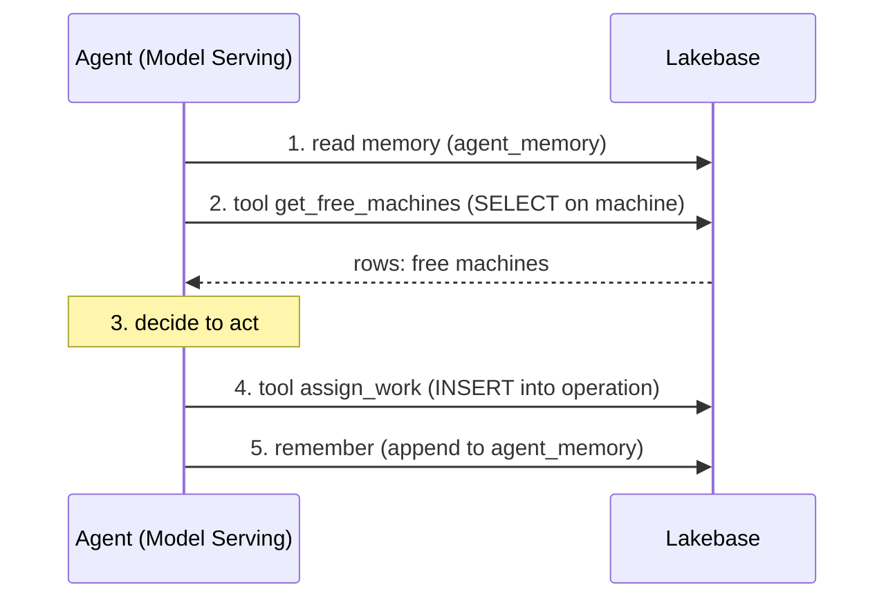

# The agent does the work

> ## What you'll learn
>
> **Key takeaways**
>
> - An agent with real function-calling reads live operational data with a tool, decides
>   to take action, and writes a state change back to the same database, all in one turn.
> - The agent's memory is durable SQL rows; on the next turn it reads that history and
>   won't repeat itself (no double-work, no lost state).
> - Tool results, actions taken, and memory are all SQL on one Lakebase instance, the
>   database is the agent backend.
>
> **You'll be able to:** ask an agent to handle a work order on the shop floor (e.g., "Release
> work order WO-1001 to machine M-204"), watch it read live machine availability with a tool,
> write a work assignment back to the database, and remember what it did so it won't double-assign.
>
> **Time:** about 20 minutes  ·  **Status:** live

## The scenario

You run the manufacturing floor. A work order (`WO-1001`: stamp 50 gearboxes) just arrived from
scheduling. The MES (Manufacturing Execution System) needs to release it to a machine, but with
one constraint: the machine must be healthy and not already running another job.

On a traditional system, the release happens through an app button, a human clicks it, or a
batch job runs on a schedule. The MES is a client of the database, not part of it. On Lakebase,
the MES can be an agent deployed on Model Serving that *reads* the current machine state with a
tool, *decides* to assign the work order, and *writes* the assignment back, all in one
transaction, with memory that prevents double-booking.

Here is what the agent does:

1. **Reads live data**: "Which machines are healthy and free?" via a SQL tool.
2. **Acts**: "Assign WO-1001 to M-204" by writing a row to the `operation` table.
3. **Remembers**: "I just assigned WO-1001 to M-204" appended to its memory, so next turn it
   won't assign the same work order twice.

No orchestration. No separate state machine. The database is the MES backend.

## What agentic work actually is

The agent's function-calling loop is:

The three tables the loop touches, all in one Lakebase database:

- `agent_memory` — what the agent has said and done (read at the start, appended at the end)
- `machine` — live status and health (read to find free machines)
- `operation` — the work assignments (written when the agent acts)

Each step reads and writes the same Lakebase database. The database enforces consistency: the
agent can't double-assign because it reads its own memory first.

## The wow moment

The beat worth watching: you ask the agent "Release WO-1001 to the shop floor." It reads the
machine table, finds M-204 is healthy and free, assigns the work order in one SQL INSERT, and
logs the action to its memory. Then you ask it the *same question again*, and it reads its
memory, sees "I already assigned WO-1001," and refuses, same transaction, no double-work. The
agent changed the state of the factory in one turn, and it remembers it.

## What you'll do

1. Connect to your branch and check the current state of machines and work orders.
2. Ask the agent to release a work order to the shop floor.
3. Watch it read machine status (the tool call) and write an assignment (the action).
4. Read the operation table to confirm the assignment was written.
5. Ask the agent the same question again; watch it remember and refuse to double-assign.

Full copy-paste steps are in [`instructions.md`](instructions.md); the exact output to check
against is in [`expected.md`](expected.md).

## Prerequisites

Finish [`../../00-setup/`](../../00-setup/) so you have a branch and can connect. You'll need a
Foundation Model API endpoint and a way to invoke the agent (the script includes a simulated
tool-calling loop if a live agent isn't deployed). This journey builds on the memory table from
[Agent memory](../agent-memory/), but you can run it standalone.

## Wrapping up

Now the agent isn't just remembering; it's also acting, reading live data and writing operational
changes. The next journey adds *learning*: the agent's actions feed back into analytics that
measure accuracy and drift. That's [Human-in-the-loop](../learning-loop/), where the agent
extracts insights with a confidence score, uncertain ones route to a human, and corrections
train the system.
