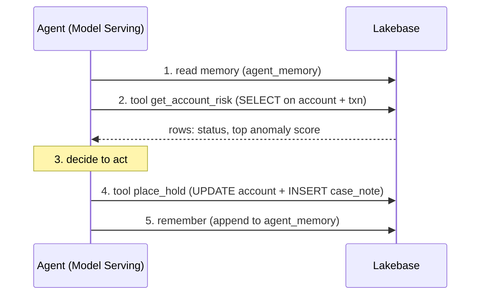

# The agent does the work

> ## What you'll learn
>
> **Key takeaways**
>
> - An agent with real function-calling reads live operational data with a tool, decides
>   to take action, and writes a state change back to the same database, all in one turn.
> - The agent's memory is durable SQL rows; on the next turn it reads that history and
>   won't repeat itself (no double-work, no lost state).
> - Tool results, actions taken, and memory are all SQL on one Lakebase instance, the
>   database is the agent backend.
>
> **You'll be able to:** ask an agent to review a flagged account (e.g., "Review ACCT-100240
> and place a hold if the fraud signal warrants it"), watch it read live transaction data with
> a tool, write a hold back to the database, and remember what it did so it won't double-hold.
>
> **Time:** about 20 minutes  ·  **Status:** live

## The scenario

You run fraud operations at a retail bank. An overnight alert just surfaced ACCT-100240: a
credit account with a transaction anomaly score that spiked to 8.7 on a card-not-present
charge. Someone needs to decide: leave it, or place a hold on the account. But with one
constraint: do not place a second hold if one is already in place.

On a traditional system, the hold happens through an app button, a human clicks it, or a batch
job runs on a schedule. The fraud system is a client of the database, not part of it. On
Lakebase, the fraud system can be an agent deployed on Model Serving that *reads* the current
account state and recent transactions with a tool, *decides* to place a hold, and *writes* the
hold back, all in one transaction, with memory that prevents double-action.

Here is what the agent does:

1. **Reads live data**: "What are the recent transactions and the top anomaly score on
   ACCT-100240?" via a SQL tool.
2. **Acts**: "Place a hold on ACCT-100240" by setting the account status to `frozen` and
   writing a flag row to the `case_note` table.
3. **Remembers**: "I just placed a hold on ACCT-100240" appended to its memory, so next turn
   it won't place the same hold twice.

No orchestration. No separate state machine. The database is the fraud-ops backend.

## What agentic work actually is

The agent's function-calling loop is:

The tables the loop touches, all in one Lakebase database:

- `agent_memory`, what the agent has said and done (read at the start, appended at the end)
- `account` and `txn`, live status and recent transactions (read to assess risk)
- `case_note` and `account.status`, the hold action (written when the agent acts)

Each step reads and writes the same Lakebase database. The database enforces consistency: the
agent can't double-hold because it reads its own memory first.

## The wow moment

The beat worth watching: you ask the agent "Review ACCT-100240 and act on the fraud signal."
It reads the account and its transactions, finds the 8.7 anomaly score, places a hold in one
transaction (status to `frozen`, a flag row in `case_note`), and logs the action to its memory.
Then you ask it the *same question again*, and it reads its memory, sees "I already placed a
hold on ACCT-100240," and refuses, same transaction, no double-work. The agent changed the
state of the account in one turn, and it remembers it.

## What you'll do

1. Connect to your branch and check the current state of the account and its transactions.
2. Ask the agent to review the flagged account and act.
3. Watch it read the account risk (the tool call) and write a hold (the action).
4. Read the account and case_note tables to confirm the hold was written.
5. Ask the agent the same question again; watch it remember and refuse to double-hold.

Full copy-paste steps are in [`instructions.md`](instructions.md); the exact output to check
against is in [`expected.md`](expected.md).

## Prerequisites

Finish [`../../00-setup/`](../../00-setup/) so you have a branch and can connect. You'll need a
Foundation Model API endpoint (the default `databricks-claude-opus-4-8` is assumed, override it
with `FM_ENDPOINT`) and a way to invoke the agent (the script includes a simulated tool-calling
loop with an honest fallback if a live agent isn't deployed). This journey builds on the memory
table from [Agent memory](../agent-memory/), but you can run it standalone.

## Wrapping up

Now the agent isn't just remembering; it's also acting, reading live data and writing
operational changes. The next journey adds *learning*: the agent's extractions feed back into
analytics that measure accuracy and drift. That's [Human-in-the-loop](../learning-loop/), where
the agent reads free-text fraud and AML case notes, extracts a finding with a confidence score,
uncertain ones route to a human analyst, and corrections write back.
